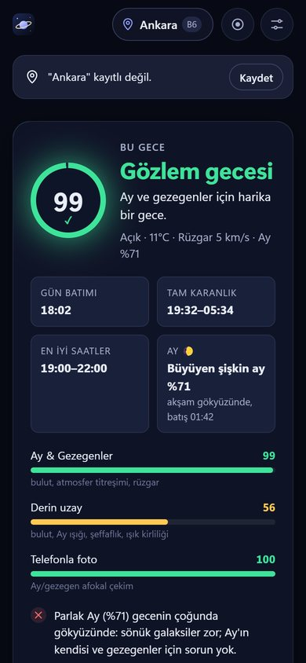
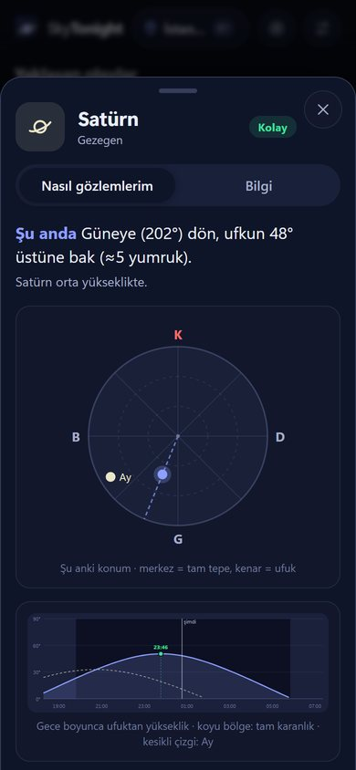
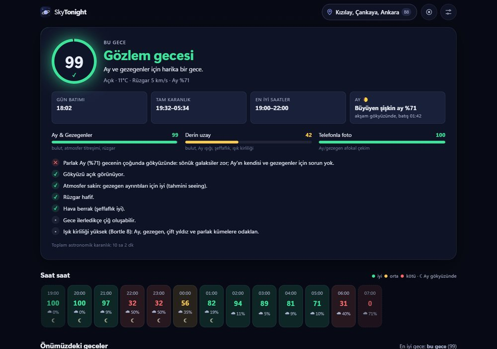

# 🔭 SkyTonight — Bu gece gözlem yapmalı mıyım?

Konumuna ve tarihe göre gecenin gözlem koşullarını hesaplayan, tek bakışta
**🟢 yeşil / 🟡 sarı / 🔴 kırmızı** karar veren ve teleskobunla (ya da çıplak gözle)
**neyi, ne zaman, hangi yönde** görebileceğini gösteren ücretsiz bir site.
Çok iyi gecelerde telefonuna **ntfy** bildirimi ve **e-posta** gönderir.

<p align="center">
  
  
</p>

## Özellikler

- **Gece skoru (0–100)** iki ayrı alt skorla:
  - *Ay & Gezegenler*: bulut, atmosfer titreşimi (jet akımından tahmini seeing), rüzgar, çiğ
  - *Derin uzay*: bulut, Ay ışığı, şeffaflık (nem, toz, ince bulut), ışık kirliliği, karanlık süre
  - Dolunay gecesi gezegenler için harika, galaksiler için kötü olabilir; site bunu ayırt eder ve **nedenini** yazar.
- **Saat saat şerit** ve **7 gecelik tahmin** (3+ gün sonrası "düşük güven" olarak işaretli).
- **Görülebilecekler listesi**: Ay, gezegenler, 109 Messier cismi, seçilmiş parlak NGC'ler, çift yıldızlar,
  parlak yıldızlar ve takımyıldızlar. Ekipmana göre filtrelenir: çıplak göz, 10×50 dürbün, 80 mm refraktör,
  **Omegon N 130/920 EQ-2**, 200 mm Dobson ya da kendi teleskobun.
- Her cisim için **Kolay / Orta / Zor / Görünmez** derecesi; ışık kirliliği, Ay ve yüksekliğe göre.
- **Nasıl gözlemlerim?** "22:30'da Güneydoğuya (135°) dön, ufkun 35° üstüne bak (≈3,5 yumruk)", gökyüzü kubbesi,
  gece boyunca irtifa grafiği, göz merceği önerisi, yıldızdan yıldıza bulma tarifi, EQ kundak ipucu.
- **Astronomi bilgisi**: ne olduğu, uzaklığı, boyutu; gezegenlerde o geceki parlaklık, çap, evre ve halka eğimi.
- **📷 Telefonla çekilebilir** etiketi: Ay ve parlak gezegenler için hava sakin ve açıksa.
- **Yaklaşan olaylar**: tutulmalar (buradan görünüp görünmeyeceği dahil), meteor yağmurları (+ Ay'ın etkisi),
  karşı konumlar, kavuşumlar, Merkür/Venüs uzanımları.
- **Kırmızı gece modu**: gözün karanlığa alışmasını bozmaz.
- **Konum**: otomatik bulma, şehir arama, birden çok konum kaydetme (her biri kendi ışık kirliliği değeriyle).
- **PWA**: iPhone'da Safari → Paylaş → *Ana Ekrana Ekle* ile uygulama gibi açılır, çevrimdışı da çalışır.



## Nasıl çalışıyor?

| Parça | Kaynak |
|---|---|
| Gezegen/Ay/yıldız konumları, doğuş-batış, alacakaranlık, tutulmalar | [Astronomy Engine](https://github.com/cosinekitty/astronomy) (NASA JPL ile doğrulanmış; testlerde JPL Horizons ve USNO ile karşılaştırılıyor) |
| Hava tahmini (bulut katmanları, nem, çiy noktası, rüzgar, jet akımı) | [Open-Meteo](https://open-meteo.com) — ücretsiz, anahtarsız |
| Toz/aerosol (şeffaflık) | Open-Meteo Air Quality |
| Derin uzay kataloğu | [OpenNGC](https://github.com/mattiaverga/OpenNGC) + elle yazılmış Türkçe metinler |
| Şehir arama / konum adı | Open-Meteo Geocoding, BigDataCloud |

Yapay zekâ kullanılmaz: bütün değerler kesin hesaplamadır. Sunucu yoktur: site GitHub Pages'te statik
olarak durur, bildirimleri GitHub Actions her gün çalıştırır. **Tamamen bedava.**

Site ve bildirim betiği aynı hesap kodunu (`core/`) kullanır; sitede gördüğün skorla telefonuna gelen
skor her zaman aynıdır.

## Kurulum

### 1. Siteyi yayınla (GitHub Pages)

1. Repo → **Settings → Pages → Build and deployment → Source: GitHub Actions** seç.
2. `main` dalına her push'ta testler çalışır ve site yayınlanır.
   Adres: `https://<kullanıcı-adın>.github.io/skytonight/`

### 2. Telefona bildirim (ntfy)

1. iPhone'a App Store'dan ücretsiz **ntfy** uygulamasını kur.
2. Sitede **Ayarlar → Çok iyi gecelerde bildirim** bölümünde adını yaz, **Rastgele oluştur** ile bir kanal adı al.
3. ntfy uygulamasında **+** → aynı kanal adına abone ol.
4. Ayarlardaki **Satırı kopyala** düğmesiyle abone satırını kopyala.

> ⚠️ ntfy kanalları herkese açıktır; adı bilen herkes bildirimleri görebilir. Bu yüzden tahmin edilemez,
> rastgele bir ad kullan. Konumun ve e-postan kodda değil, GitHub Secret'ta saklanır.

### 3. Abone listesini GitHub'a ekle

Repo → **Settings → Secrets and variables → Actions → New repository secret**

- **Name:** `NOTIFY_SUBSCRIBERS`
- **Secret:** kopyaladığın satırları köşeli parantez içinde, virgülle ayırarak yapıştır:

```json
[
  {"name":"Ben","place":"Ev","lat":41.01,"lon":28.97,"bortle":7,"equipment":"omegon130","threshold":80,"until":2,"ntfy":"skytonight-ben-x8k2q7ab"},
  {"name":"Arkadaşım","place":"Yazlık","lat":37.03,"lon":27.43,"bortle":4,"equipment":"eye","threshold":75,"email":"arkadas@ornek.com"}
]
```

| Alan | Açıklama |
|---|---|
| `lat`, `lon` | Konum (zorunlu) |
| `bortle` | Işık kirliliği 1 (çok karanlık) – 9 (şehir merkezi) |
| `equipment` | `eye`, `bino10x50`, `refractor80`, `omegon130`, `dob200` |
| `threshold` | Bildirim eşiği (varsayılan 80) |
| `until` | En geç saat (ör. `2` = 02:00, `23` = 23:00, `null` = sabaha kadar) |
| `ntfy` / `email` | En az biri gerekli |

Eşik aşılmasa bile o gece önemli bir olay (meteor zirvesi, tutulma, yakın kavuşum) varsa ve hava
"idare eder" seviyesindeyse (≥ 50) de bildirim gelir.

### 4. (İsteğe bağlı) E-posta

Gmail'de **2 Adımlı Doğrulama** açık olmalı. Sonra [uygulama şifresi](https://myaccount.google.com/apppasswords)
oluştur ve iki secret daha ekle:

- `SMTP_USER` → Gmail adresin
- `SMTP_PASS` → 16 haneli uygulama şifresi (normal şifren değil)

### 5. Test et

**Actions → Gece bildirimi → Run workflow**

- `dry_run` açık: hiçbir şey göndermez, mesajları logda gösterir.
- `dry_run` kapalı + `force` açık: eşiği yok sayıp gerçekten gönderir. Telefonuna gelirse kurulum tamam.

Sonrasında iş akışı her gün **16:00 (TR)** civarında kendiliğinden çalışır.

> GitHub, public repolarda 60 gün boyunca hiç değişiklik olmazsa zamanlanmış işleri durdurabilir. İş akışı
> bunu önlemek için kendini her gün "etkin" olarak işaretler; yine de durursa GitHub sana e-posta atar,
> **Actions → Gece bildirimi → Enable workflow** ile tekrar açman yeterli.

## Yerel geliştirme

Gereken: Node.js 20+ (testler ve bildirim betiği için). Site için derleme adımı yoktur.

```bash
npm install          # astronomy-engine + nodemailer
npm test             # 44 test: astronomi doğruluğu, skor mantığı, görünürlük, olaylar
npm run serve        # http://localhost:8000
npm run notify:dry   # bildirim betiğini deneme modunda çalıştır (NOTIFY_SUBSCRIBERS gerekli)
```

Kataloğu yeniden üretmek için (yalnızca `data/src/` değişirse; Python 3 gerekir):

```bash
python scripts/build_catalog.py
```

### Klasör yapısı

```
core/       Tarayıcı + Node ortak hesap kodu (DOM yok, saf fonksiyonlar)
  astro.js       konumlar, gece penceresi, Ay
  weather.js     Open-Meteo hava tahmini
  scoring.js     gece skoru ve gerekçeler
  visibility.js  ekipman + ışık kirliliği → Kolay/Orta/Zor/Görünmez
  objects.js     "bu gece neler görülür" listesi
  events.js      tutulma, meteor, karşı konum, kavuşum
  night.js       bir gecenin bütün değerlendirmesi
js/         Yalnızca tarayıcı: arayüz bileşenleri, tercihler, konum servisleri
css/        Tasarım (tokens.css: renkler ve kırmızı gece modu)
data/       Katalog, gezegen metinleri, takımyıldızlar, meteor yağmurları
notifier/   Günlük bildirim betiği (GitHub Actions)
scripts/    Katalog/ikon üretimi, geliştirme sunucusu
tests/      node:test testleri
```

## Bilinen sınırlamalar

- Hava tahmini kesin değildir; bulut saatleri kayabilir. Son karar için gökyüzüne bir de kendin bak.
- Seeing (atmosfer titreşimi) jet akımı rüzgarından **tahmin** edilir; özel astronomi modelleri kadar ince değildir.
- Işık kirliliği (Bortle) konum başına elle seçilir; Ayarlar'daki bağlantıyla haritadan bakabilirsin.
- Kuyruklu yıldızlar ve ISS geçişleri henüz yok.

## Lisans ve atıflar

- Kod: [MIT](LICENSE)
- `data/catalog.json`, [OpenNGC](https://github.com/mattiaverga/OpenNGC) verisinden türetilmiştir ve
  **CC-BY-SA 4.0** lisansı altındadır.
- Hava: [Open-Meteo](https://open-meteo.com) (CC-BY 4.0) · Gökyüzü hesabı: [Astronomy Engine](https://github.com/cosinekitty/astronomy) (MIT)
